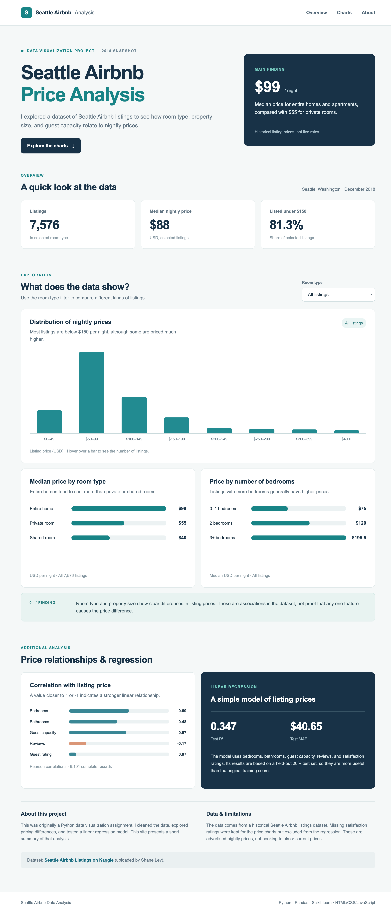

# Seattle Airbnb Price Analysis

This project analyzes Airbnb listing prices in Seattle using Python. I used a dataset of 7,576 listings to explore how room type, bedrooms, and other property features relate to nightly prices.

I also created a simple interactive dashboard to display the results.

[View Live Dashboard](https://markjmcclellan.github.io/seattle-airbnb-analysis/)

## Features

- Data cleaning and analysis using Python
- Interactive dashboard with a room-type filter
- Charts comparing listing prices and property characteristics
- Linear regression to explore factors related to price

## Main Findings

- The median nightly price was $88.
- Entire homes and apartments generally cost more than private and shared rooms.
- Listings with more bedrooms tended to have higher prices.
- The linear regression model had a test R² of approximately 0.35.

## Technologies Used

- Python (Pandas, Scikit-learn)
- HTML
- CSS
- JavaScript

## Viewing the Project

[View Live Dashboard](https://markjmcclellan.github.io/seattle-airbnb-analysis/)

The dashboard displays the results of my Seattle Airbnb analysis. The Python code used to process and analyze the dataset is included in analysis.py.

## Dataset

The dataset was obtained from [Seattle Airbnb Listings on Kaggle](https://www.kaggle.com/datasets/shanelev/seattle-airbnb-listings).

The data is from 2018, so the results do not represent current Airbnb prices. The original CSV is included in this repository.
